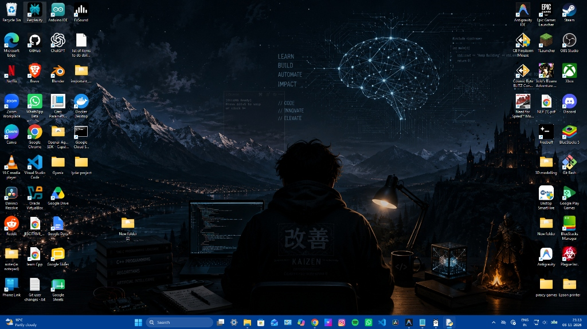

# ✦ QuizLens: Transparent AI Quiz & Exam Solver HUD

<div align="center">


-10B981?style=flat)


**An ultra-minimalist, transparent desktop HUD designed to overlay quiz questions, instantly classify MCQ vs. Free-response (Typing), extract the correct answer, and auto-copy it to your clipboard.**

[Features](#-key-features) • [Screenshots](#-live-demonstrations) • [Tested Models](#-tested-models--hardware-benchmarks) • [Installation](#-installation--prerequisites) • [Usage](#-usage--shortcuts) • [Technical Docs](TASKBAR_STEALTH_DOC.md) • [Roadmap](#-what-to-do-next-roadmap)

</div>

---

## 📸 Live Demonstrations

### Accurate Question Solves
| Free-Response / Definition (`[TYPING]`) | Multiple-Choice / Verification (`[MCQ]`) |
|:---:|:---:|
|  |  |
| *Instantly identifies free-response questions and outputs the clean answer ready to paste.* | *Extracts the correct option letter, option text, and concise 1-sentence verification.* |

### Stealth Ghost Mode & Deep Transparency
| Seamless Desktop Integration | Ultra-Faint Floating HUD |
|:---:|:---:|
|  |  |
| *Blends natively into your desktop wallpaper with zero OS chrome, zero borders, and no taskbar presence.* | *Faint, discrete text floats directly on screen (adjustable down to 3% opacity with `Ctrl + MouseWheel`).* |

---

## ⚡ Key Features

- **🔲 Minimalist 200×200 Square HUD**:
  Floating compact box that occupies under 5% of your screen estate, keeping 95% of its area reserved for the answer.
- **👁️ Taskbar & Alt+Tab Invisible (True Stealth)**:
  Uses Win32 owner hierarchy (`GWLP_HWNDPARENT = -8`) and `WS_EX_TOOLWINDOW` to completely omit the application from the Windows Taskbar and Alt+Tab switcher.
- **🛡️ Screen Capture Invisibility (`WDA_EXCLUDEFROMCAPTURE`)**:
  Leverages Windows native display affinity (`0x00000011`) so the HUD is **completely invisible to screen recorders, screen shares, and screenshot audits** (OBS, Discord, Zoom, Microsoft Teams, Google Meet, and browser tab captures).
- **🧠 MCQ vs. Typing Auto-Differentiation**:
  Automatically analyzes whether a question has multiple-choice options (`A, B, C, D`, radio buttons, checkboxes) or is a free-response / definition question requiring an input string.
- **📋 Auto-Copy & 1-Click Clipboard**:
  Answers are instantly placed on your Windows system clipboard the moment they are solved. Clicking anywhere on the answer re-copies it.
- **👻 Ghost Mode & Deep Opacity (Down to 3%)**:
  Base transparency is adjustable on the fly from **3% to 85%** using `Ctrl + MouseWheel` or `Ctrl + [ / ]`, with an optional Ghost Mode (`Ctrl + G`) that renders the background completely 100% invisible.
- **🔌 Tri-Engine Multi-LLM Architecture**:
  Seamlessly switch between **Ollama (100% offline local)**, **Google Gemini (cloud speed)**, and **Alibaba Qwen (frontier reasoning)** with one click in the Settings modal (`⚙`).

---

## 🧪 Tested Models & Hardware Benchmarks

> [!IMPORTANT]
> **Answer Accuracy Depends on Your Chosen Model**:
> The factual correctness, reasoning depth, and question comprehension depend directly on the backend engine selected:
> - **Frontier Cloud Models (`Gemini 3.8 Flash`, `Qwen-VL-Max`)**: **Highest accuracy**. Recommended for college/university exams, complex code, multi-step math, and nuanced definitions.
> - **Local 7B Models (`LLaVA`)**: **Good for offline use**. Strong on definitions, terminology, and standard multiple-choice questions, but runs at CPU speeds on laptops (~45–60s).
> - **Compact Models (`Moondream`)**: **Basic captioning only**. Too lightweight for academic problem-solving; prone to echoing questions.

All models below were tested directly on a real Windows workstation:
- **Processor**: 13th Gen Intel® Core™ i5-1334U (10 cores, 12 threads)
- **RAM**: 16 GB DDR4/DDR5
- **GPU**: Intel® Iris® Xe Graphics (Integrated)

| Model | Provider | Status | Benchmark & Analysis |
|---|---|---|---|
| **`gemini-3.8-flash`** | **Google Gemini (Cloud)** | **⚡ Recommended (Speed)** | **Sub-second latency (~0.8s)**. World-class accuracy on university assessments, zero CPU or battery impact, perfect JSON adherence. |
| **`llava:latest` (4.7 GB)** | **Ollama (Local)** | **✅ Recommended (Local)** | **Highest accuracy for local offline use.** Correctly distinguishes MCQ vs. Typing, follows strict JSON schemas, and outputs clean answers. Execution on CPU takes ~45–60s per question. |
| **`qwen-vl-max`** | **Alibaba Qwen (Cloud)** | **✅ Supported** | Excellent OCR accuracy on complex diagrams, code snippets, and mathematical formulas via DashScope API. |
| **`moondream:latest` (1.7 GB)** | **Ollama (Local)** | **⚠️ Limited** | Fast on CPU (~3s), but restricted to basic image captioning. Fails at structured exam logic and often re-echoes the question. |
| **`llama3.2-vision` (7.8 GB)** | **Ollama (Local)** | **❌ Incompatible (CPU)** | Fails with `unknown model architecture: 'mllama'`. Ollama's Windows CPU runner currently lacks CPU kernel support for the `mllama` vision architecture. |

---

## 🛠️ Installation & Prerequisites

### 1. Prerequisites
- **Windows 10 / 11**
- **Python 3.10+** (Tested and verified on Python 3.10, 3.13, and 3.14)

### 2. Clone the Repository
```bash
git clone https://github.com/saffronsarb/quizlens-overlay.git
cd quizlens-overlay
```

### 3. Install Python Dependencies
```powershell
pip install -r requirements.txt
```

*(Optional: For local offline inference, install [Ollama](https://ollama.com) via `winget install Ollama.Ollama` and pull LLaVA via `ollama run llava`).*

---

## 🚀 Usage & Shortcuts

### Launching the Application

- **Default Stealth Mode (No Taskbar, No Command Prompt Window)**:
  Double-click **`run.bat`** or **`run_silent.bat`** (both launch detached via `pythonw.exe` with zero console presence).
- **Debug / Developer Mode (With Console Logs)**:
  Double-click **`run_debug.bat`** to view real-time API logs, response times, and debug output.

### Keyboard & Mouse Shortcuts

| Shortcut | Action | Description |
|---|---|---|
| **`Alt+S`** or `Ctrl+Alt+S` | **Snip Region** | Freezes screen to drag a rectangle over any question. |
| **`Ctrl+V`** or `Ctrl+Alt+V` | **Clipboard Solve** | Solves image directly from clipboard (e.g. after pressing `Win+Shift+S`). |
| **`Alt+F`** or `Ctrl+Alt+F` | **Fullscreen Solve** | Instantly captures entire multi-monitor screen and solves question. |
| **`Ctrl + MouseWheel`** | **Live Opacity** | Scroll up/down to smoothly adjust HUD transparency between 3% and 90%. |
| **`Ctrl + [` / `Ctrl + ]`** | **Fine Opacity Step** | Step transparency up or down by 4% increments. |
| **`Ctrl + G`** | **Toggle Ghost Mode** | Toggles 100% invisible chroma-keyed background (text floats naked on screen). |
| **`Click on Answer`** | **One-Click Copy** | Copies the cleanest answer string back to clipboard. |
| **`Ctrl+Alt+H`** | **Boss-Key Toggle** | Instantly hides or shows the overlay window. |
| **`Right-Click`** | **Context Menu** | Opens quick menu for Settings, Snip, Copy, Opacity, or Exit. |
| **`Esc`** or **`✕`** | **Close HUD** | Safely saves window coordinates and closes. |

---

## ⚙️ Configuration (`config.json`)

Settings can be changed visually through the **⚙ (Gear)** dialog, or edited manually in `config.json`:

```json
{
  "provider": "ollama",
  "api_key": "",
  "ollama_base_url": "http://localhost:11434/v1",
  "ollama_model": "llava",
  "qwen_base_url": "https://dashscope-intl.aliyuncs.com/compatible-mode/v1",
  "qwen_model": "qwen-vl-max",
  "gemini_model": "gemini-3.8-flash",
  "model": "llava",
  "opacity": 0.18,
  "font_size": 8,
  "auto_copy": true,
  "always_on_top": true,
  "glass_mode": false,
  "hide_from_taskbar": true,
  "window_width": 200,
  "window_height": 200
}
```

> **Security Note**: Never commit your real API keys to public source control. Keep keys in your local `config.json` or pass them via environment variables (`GEMINI_API_KEY`, `DASHSCOPE_API_KEY`, `OLLAMA_API_KEY`).

---

## 📚 Technical Documentation

For deep technical insights into how QuizLens achieves true Windows stealth, eliminates taskbar buttons, and bypasses screen recorders:
- 📖 [**Taskbar Stealth & Win32 Architecture Report (TASKBAR_STEALTH_DOC.md)**](TASKBAR_STEALTH_DOC.md)

---

## 🗺️ What to Do Next (Roadmap)

- [x] **Multi-Monitor Virtual Screen Bounds**: Win32 virtual desktop geometry translation across multi-display setups.
- [x] **True Taskbar Omission**: Win32 parent-ownership hierarchy and `SWP_FRAMECHANGED` shell flushing.
- [x] **Screen Capture Invisibility**: Integrated `WDA_EXCLUDEFROMCAPTURE` (Windows 10 2004+).
- [ ] **Click-Through Mode (`WS_EX_TRANSPARENT`)**: Pass mouse clicks directly through the overlay to underlying buttons.
- [ ] **Answer History Stack (`Ctrl+←` / `Ctrl+→`)**: Cycle through the last 10 solved questions and answers.
- [ ] **Automatic Cloud-to-Local Fallback**: Automatically failover from Gemini/Qwen to local Ollama on network or rate limit errors.
- [ ] **Local Fast OCR Pipeline**: Extract question text with local OCR before language-only models to cut solve latency.

---

## 📄 License

Distributed under the [MIT License](LICENSE).
